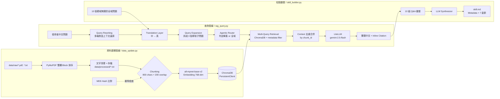

[](https://classroom.github.com/a/mhxNhwtV)

# HW3：個人知識 RAG 系統 — AI 繪圖技術演進與知名架構

從零打造的個人知識 RAG 系統，專注收錄 **2020–2026 年 AI 影像生成 (AI Image Generation)** 領域的 arXiv 學術論文，支援冪等性增量更新、多輪中文對話、智能路由與跨語系檢索，並能自動彙整成 `skill.md` 技能文件。

---

## 1. 專案簡介

### 1.1 知識主題與選擇理由

本專案的知識主題為 **AI 繪圖 / 影像生成技術演進（Generative AI for Visual Content Generation）**，涵蓋擴散模型 (Diffusion Models)、DiT、Flow Matching、LoRA、對齊 (Alignment) 與安全性 (Safety)、個性化生成 (Personalization)、影片生成 (Video Generation) 與評估指標 (Evaluation Metrics) 等主題。

選擇此主題的理由：
- **領域具深度與高度專業術語**：學術論文是 RAG 系統最大痛點的集中地（雙欄排版、跨語系、專有名詞代詞化），是驗證 RAG pipeline 設計的絕佳場域。
- **近年變化劇烈**：從 2020 的 DDPM、2022 的 LDM/Stable Diffusion、2023 的 DiT、2024–2026 的 Sora / Flux / Seedream 等，技術脈絡清晰，利於觀察趨勢演進。
- **個人興趣與實務需求**：筆者日常研究涉及影像生成領域，親自建構的 RAG 可作為持續使用的知識查詢助手。

### 1.2 資料來源

| 項目 | 規模 |
|---|---|
| 文件總數 | **41 份** |
| 文件格式 | `.pdf`（皆為 arXiv 論文或技術報告）；同時支援 `.txt` |
| 時間範圍 | **2020 – 2026 年**（從 DDPM 到最新 Flow Matching、DiT 類模型） |
| 領域涵蓋 | 擴散模型核心、架構演進（DiT / Flow Matching）、個性化 (LoRA / DreamBooth / IP-Adapter)、對齊與安全、影片生成、評估與基準測試 |

### 1.3 系統架構與技術選型

| 元件 | 選型 | 說明 |
|---|---|---|
| PDF 文字提取 | **PyMuPDF (fitz)** | 使用 `get_text("blocks")` 取得座標，自訂啟發式排序解決雙欄排版問題 |
| Chunking 策略 | 固定長度 + Overlap | `chunk_size=800`, `overlap=200`，以空白為軟邊界避免切斷英文單字 |
| Embedding 模型 | **`all-mpnet-base-v2`**（768 維） | 純英文高品質模型，語意捕捉優於多語系小模型 |
| Vector DB | **ChromaDB**（PersistentClient） | 純 Python，零維運，無需 Docker，適合個人級 RAG |
| LLM 呼叫層 | **LiteLLM** + OpenAI 格式 client | 統一介面，預設 `gemini-2.5-flash` |
| 檢索策略 | Translation → Query Expansion → Multi-Query Retrieval → Agentic Routing | 中文問題先翻譯，再擴展 3 個子問題，多次檢索後去重 |
| 輸出生成 | 行內引用 `[Chunk X]` + 融合式繁體中文敘事 | 系統 Prompt 嚴格規範避免 QA 列表式回答 |

---

## 2. 系統架構說明



---

## 3. 設計決策（Design Decisions）

本章節為本專案核心。以下逐一說明每個技術節點的選擇、痛點、解法與取捨。

### 3.1 Chunking 策略：固定長度 + Overlap + 軟邊界

- **策略**：固定字元長度切分 `chunk_size=800`，`overlap=200`（25% 重疊）。
- **軟邊界處理**：若切割點落在英文單字中間，會向前掃描到最近的空白處才切，避免把 `Transformer` 切成 `Trans` / `former`。
- **為何選固定長度而非語意邊界**：
  - 學術論文排版多樣（標題、公式、表格、Bullet list），純語意切分（如依章節）容易出現某段超過 2k 字元、某段只有 50 字元的極端值，對 embedding 品質不利。
  - 固定 800 字元（約 150–200 英文 token）是 `all-mpnet-base-v2` 最大上下文 (512 tokens) 的安全區間。
- **為何 overlap 要 200**：解決跨 chunk 的語意斷裂。例如一個關鍵句「Flux uses rectified flow for…」若剛好落在切點，overlap 可確保兩個 chunk 都涵蓋完整敘述。
- **額外的預處理：雙欄排版還原（PyMuPDF Heuristic Block Sorting）**
  - **痛點**：arXiv 論文幾乎全為雙欄排版。傳統文字提取會把左右欄水平拼接，導致「第一行 = 左欄首行 + 右欄首行」的亂碼 chunk。
  - **解法**：改用 `PyMuPDF.get_text("blocks")` 取得每個文字區塊及其 (x0, y0, x1, y1) 座標，再以啟發式規則排序：先以 `round(y / 50)` 將座標相近者歸為同一行（容錯），再依 x 座標由左至右、由上至下排序。
  - **效果**：完整還原雙欄閱讀順序，確保 chunk 具備連續語意。

### 3.2 Embedding 模型：`all-mpnet-base-v2`（768 維，純英文）

- **為何不用多語系模型**：
  - 最初嘗試 `paraphrase-multilingual-MiniLM-L12-v2`（384 維），發現在「DiT architecture」、「classifier-free guidance」等高維學術詞彙上的語意捕捉不及純英文頂級模型，常出現跨語系對齊失敗 (Cross-lingual Mismatch)。
- **為何選 `all-mpnet-base-v2`**：
  - 768 維空間能承載更細緻的語意距離。
  - 在 MTEB 英文 benchmark 上長期位於頂級 open-source 模型之列，對學術語料表現優異。
- **中文問題怎麼辦？基於翻譯的跨語系檢索（Translation-based Cross-lingual RAG）**
  - 在 `rag_query.py` 中加入翻譯層（Translation Layer）：使用者輸入中文後，先呼叫 LLM 將其翻譯成具學術精準度的英文 query，再拿英文去英文資料庫檢索。
  - **取捨**：多一次 LLM call（~200ms、極少 token），換取大幅提升的檢索精準度。
- **本地 vs API 的取捨**：
  - 本地 (sentence-transformers)：零成本、無網路依賴、無 rate limit，但初次下載 ~420MB、需要 CPU/GPU。
  - API（如 OpenAI embedding）：品質略優但有費用和 quota 壓力。
  - 本作業規模（41 份 × ~50 chunks ≈ 2000 embeddings），本地方案綽綽有餘。

### 3.3 Vector DB：ChromaDB

- **為何選 ChromaDB**：
  - **零維運**：`PersistentClient(path=...)` 一行啟動，不需 Docker、不需啟動 server 程序，`git clone` 後直接能跑。
  - **原生 Python**：可直接在腳本中 import，無 network overhead。
  - **Metadata filter 語法友善**：支援 `where={"source": {"$in": [...]}}`，完美搭配本專案 Agentic Routing 設計。
- **評估過的替代方案**：
  - **pgvector**：功能強、適合生產環境，但需要 Docker + `.env` 連線字串管理，對個人級作業過重。
  - **Qdrant**：效能優，但同樣需要 server 啟動流程。
  - **FAISS**：純向量索引，缺少 metadata filter 能力，不適合本專案的 Agentic Routing。
- **結論**：本作業資料規模（~2000 chunks）ChromaDB 讀寫延遲可忽略，選它是正確取捨。

### 3.4 Retrieval 策略：Translation → Expansion → Routing → Multi-Query

本專案檢索端是整個 RAG 最複雜的部分，依序做了四件事：

1. **Query Rewriting（多輪對話支援）**：若存在對話歷史，先把使用者短問題（如「它的架構呢？」）還原成獨立的完整問題（如「Flux 模型的架構是什麼？」）。
2. **Translation Layer**：見 3.2。
3. **Query Expansion & Decomposition**：
   - **痛點**：使用者提問常過於口語（如「Flux 模型長怎樣？」），向量檢索難以對上論文裡的專業詞彙。
   - **解法**：呼叫 LLM 作為 Query Planner，將意圖展開為 **3 個涵蓋「架構設計 (Architecture)、核心機制 (Mechanisms)、優勢對比 (Advantages)」的學術子問題**，連同原問題共 4 個 query。
   - **效果**：召回率 (Recall) 大幅提升，避免短查詢在論文庫裡 miss。
4. **Agentic Auto-Router（智能路由）**：
   - **痛點**：論文有「代詞陷阱（Pronoun Trap）」—— 論文內文常用 "our model" 而非全名，純向量檢索在「XXX 模型的架構是什麼？」這類問題會給錯答案。
   - **解法**：檢索前讓 LLM 看 DB 中所有 `source` 檔名清單，判斷使用者是否在問特定論文；若是，回傳該檔名，ChromaDB 檢索時動態加上 `where={"source": target_filename}` 做 metadata filter，進入「單篇精讀」模式；否則進入「跨文獻全域」模式。
   - **效果**：使用者不需記得任何 metadata，系統自動在狙擊與全域模式間切換。
5. **Multi-Query Retrieval + Chunk Deduplication**：
   - 對 4 個 query 各自做 `top_k=4` 的檢索，得到最多 16 個候選 chunk。
   - 以 `chunk_id = f"{source}_chunk_{chunk_index}"` 做 set 去重，輸出最終 context。
- **Top-K 設定**：每個子 query 取 4，去重後實測平均得 8–12 個 chunk，既涵蓋多角度又避免 context 稀釋。
- **是否用 Reranking**：暫未導入。目前透過 Query Expansion + 多 query 合併的策略已有良好效果；未來若擴大資料規模，可加入 cross-encoder reranker 進一步精修排序。

### 3.5 Prompt Engineering：融合式生成 + 行內引用

- **痛點**：Context 同時含多個子問題的知識碎片、純英文來源，若 Prompt 控制不當，LLM 容易：
  - 逐條回答每個子問題，變成 QA 清單；
  - 直接用英文回覆，違反繁體中文要求；
  - 不引用來源，無法溯源。
- **解法（`rag_query.py` 的 `generate_answer`）**：設計嚴謹的 System Prompt，強制 LLM：
  1. 只回答 **[User's Core Question]**，擴展子問題僅供內部分析使用、**不准單獨回答**。
  2. 必須融合資訊成一段技術摘要 (Technical Briefing)，避免列點 Q&A 式輸出。
  3. 所有敘述僅能基於 [Reference Materials]，資料不足時明確宣告。
  4. **強制行內引用 (Inline Citation)**：引用資訊時必須使用 `[Chunk X]` 格式。
  5. **語言鎖定**：無論 context 為英文，輸出必須為流暢的繁體中文。
- **Temperature**：生成設 `0.3`（平衡一致性與流暢度），Query Rewriting / Translation / Routing 等結構化任務設 `0.0`（絕對穩定）。

### 3.6 Idempotency：MD5 Hash + Source Metadata

- **需求**：每次跑 `data_update.py` 後，DB 狀態必須完整反映 `data/raw/` 最新內容，不可累積舊資料。
- **設計**：
  1. 計算原始檔案 MD5：`file_hash(raw_path)`。
  2. 將 `hash` 寫入該檔所有 chunk 的 metadata：`{"source": filename, "chunk_index": i, "hash": current_hash}`。
  3. 增量更新時，用 `collection.get(where={"source": filename})` 取回既有的 hash 比對：
     - 相同 → 跳過（`continue`）。
     - 不同（含首次處理）→ `collection.delete(where={"source": filename})` 清掉舊 chunks，再重新抽 chunking + embedding。
- **`--rebuild` 旗標**：直接 `shutil.rmtree(processed_dir)` + `shutil.rmtree(CHROMA_PERSIST_DIR)`，從零重建。
- **為何用 MD5 而非 mtime**：mtime 會因 `git clone` 或檔案搬移而變，但內容未變；MD5 只認內容，更穩健。

### 3.7 `skill_builder.py` 的 10 個全域問題設計

- **設計原則**：問題必須 **領域無關 (domain-agnostic)**，不預設系統知道知識庫主題為何，讓 RAG 自行從資料中歸納出「領域是什麼、有哪些核心概念」。
- **10 個問題的覆蓋意圖**：

    | # | 問題 | 對應 skill.md 章節 |
    |---|---|---|
    | 1 | 涵蓋主題、範圍、讀者 | Overview |
    | 2 | 核心概念、理論、技術 | Core Concepts |
    | 3 | 發展趨勢、演進方向 | Key Trends |
    | 4 | 關鍵人物、機構、產品、模型 | Key Entities |
    | 5 | 方法論、架構、pipeline | Methodology |
    | 6 | 工具、框架、資料集 | Methodology / Entities |
    | 7 | 挑戰、技術限制、未解問題 | Knowledge Gaps |
    | 8 | 最佳實踐、標準做法 | Best Practices |
    | 9 | 方法取捨 (trade-offs) | Knowledge Gaps |
    | 10 | 實驗結果、評估指標、案例 | Example Q&A |

- **為何正好 10 題**：章節覆蓋需至少 7 題（對應 7 個必要章節），再加上「最佳實踐 / 取捨 / 案例」各一題，確保 Core Concepts、Entities、Methodology 等重要章節有多個視角的資料可供彙整。
- **彙整流程**：每題完整跑一次 RAG pipeline（翻譯 → 擴展 → 檢索 → LLM 生成繁體中文回答），產出 10 組 Q&A 後交由 LLM synthesizer 整理成 `skill.md` 主體，Metadata 與 Source References 由程式直接產生避免 LLM 幻覺。

---

## 4. 環境設定與執行方式

### 4.1 Python 版本與虛擬環境

本專案要求 **Python >= 3.10**，開發與測試使用 **Python 3.12.8**。

```bash
# Step 0：確認 Python 版本
python3 --version
# 應顯示 Python 3.10+（建議 3.12.8）

# Step 1：建立虛擬環境（標準 venv）
python3 -m venv .venv

# Step 2：啟動虛擬環境
source .venv/bin/activate                 # Linux / macOS
# .venv\Scripts\activate                  # Windows PowerShell

# 啟動成功後命令列會出現 (.venv) 前綴

# Step 3：安裝套件
pip install -r requirements.txt
```

### 4.2 Vector DB 啟動說明

本專案使用 **ChromaDB**（純 Python 嵌入式，無需 server）。

- **無需 `docker-compose.yml`**，不需啟動任何 container。
- 資料落地位置由 `.env` 中的 `CHROMA_PERSIST_DIR` 指定，預設為 `./chroma_db`。
- 程式首次執行會自動建立該目錄與 collection。

### 4.3 完整執行流程（從零複現）

```bash
# ① 確認 Python 版本
python3 --version           # 需 >= 3.10

# ② 建立並啟動虛擬環境
python3 -m venv .venv
source .venv/bin/activate

# ③ 安裝套件
pip install -r requirements.txt

# ④ 設定環境變數
cp .env.example .env
# 編輯 .env：填入助教提供的 LITELLM_API_KEY 與 LITELLM_BASE_URL
# EMBEDDING_MODEL 預設為 all-mpnet-base-v2（首次執行 sentence-transformers 會自動下載 ~420MB）

# ⑤ 啟動 Vector DB
# 本專案使用 ChromaDB，無需 docker compose，此步驟跳過

# ⑥ 全量重建索引（首次執行建議加 --rebuild）
python data_update.py --rebuild
# 預期輸出：Total documents in DB: ~2000 左右（視論文長度）

# ⑦ 測試 RAG 問答
python rag_query.py --query "請問這個知識庫的核心主題是什麼？"

# ⑧ 進入互動式多輪對話（可選）
python rag_query.py

# ⑨ 生成 Skill 文件
python skill_builder.py --output skill.md
```

### 4.4 常用指令參數

| 指令 | 常用參數 | 說明 |
|---|---|---|
| `data_update.py` | `--rebuild` | 清空所有 processed 與 ChromaDB 資料後全量重建 |
| `rag_query.py` | `--query "..."` | 單次查詢模式；省略則進入互動式對話 |
| `rag_query.py` | `--top-k 4` | 每個擴展子 query 檢索的 chunk 數（預設 4） |
| `rag_query.py` | `--model gemini-2.5-flash` | 指定 LiteLLM 使用的模型 |
| `rag_query.py` | `--source paper.pdf` | 強制鎖定特定 PDF 檢索（覆蓋 auto-router） |
| `skill_builder.py` | `--output skill.md` | 輸出檔案路徑 |
| `skill_builder.py` | `--top-k 4` | 每個子 query 的 chunk 數 |

### 4.5 輸出檔案結構

```
hw3-build-your-personal-rag-Au-Neptune-1/
├── data/
│   ├── raw/               # 原始 PDF / TXT（41 份）
│   └── processed/         # 清理後純文字（commit 用，助教可驗證）
├── chroma_db/             # ChromaDB persist 目錄（已加入 .gitignore）
├── data_update.py
├── rag_query.py
├── skill_builder.py
├── skill.md               # Phase 2 自動產出
├── requirements.txt
├── .env.example
└── README.md
```

---

## 5. 資料來源聲明（Data Sources Statement）

本專案所有資料均取自公開渠道，使用於個人學術學習與 RAG 系統建構之非商業研究用途。

| 來源名稱 | 類型 | 授權 / 合規依據 | 數量 |
|---|---|---|---|
| arXiv 預印本論文（arXiv.org） | PDF | 依 arXiv 各論文作者選擇之授權（多為 arXiv.org perpetual, non-exclusive license 或 CC BY 4.0 / CC BY-NC 4.0）；僅作非商業研究與教學引用 | 38 篇 |
| 官方技術報告 / 技術 Blog（OpenAI Sora Review、Flux Demystified 等） | PDF | 原始發布機構之公開技術報告，依其 Terms of Use 作非商業學術引用 | 3 篇 |
| **總計** | — | — | **41 份** |

**合規性說明**：
- 所有 PDF 均從 arXiv.org 或原始發布網站直接下載，未經任何修改或再散佈。
- 本 repo 內 `data/raw/` 下的 PDF 僅作為 RAG 系統檢索的輸入資料使用，未作二次散佈或商業用途。
- 生成的 `skill.md` 會在 Source References 章節標註每一個實際被引用的原始檔名，確保知識可溯源。
- 若有任何作者不希望其論文被納入本學術作業之索引，請透過 GitHub Issue 聯絡，我會立即移除。

---

## 6. 系統限制與未來改進

### 6.1 目前已知限制

1. **Chunking 粒度固定**：目前採用固定字元長度 (800/200) 切分，對於含公式、表格、figure caption 的學術論文段落，容易把一個完整的演算法說明切成兩半；未針對 Markdown heading / LaTeX section 做結構化切分。
2. **未導入 Reranker**：Query Expansion 後雖能提升 Recall，但 top-k 內的排序仍只依賴 embedding cosine similarity，偶爾出現「最相關的 chunk 排第 3、第 4」的情況，LLM 讀取時可能被前序低相關 context 稀釋注意力。
3. **Agentic Router 依賴檔名關鍵字**：路由判斷本質是讓 LLM 看檔名清單做字串比對，若未來檔名不規範（如 `paper1.pdf`），路由器會失效；較穩健的做法應基於每份文件的摘要或 metadata index。
4. **翻譯層的語意漂移**：中文 → 英文翻譯雖提升檢索精準度，但面對帶有中文文化語境的提問（例如比喻、雙關），LLM 翻譯後可能失真，導致檢索到非預期文獻。
5. **無 Evaluation Pipeline**：目前仰賴人工檢視回答品質，沒有自動化的 RAG 評估框架（如 RAGAS、TruLens）來量化 retrieval precision / answer faithfulness。
6. **影片與圖像資料缺席**：本 RAG 全為文字檢索，雖主題是 AI 繪圖，但無法檢索論文中的架構圖、範例圖、demo 影片，這對視覺技術領域是明顯缺口。
7. **Token / 成本未做守護**：每次查詢會呼叫 LLM 4–5 次（翻譯、擴展、路由、生成，多輪時加上 Rewriting），在 `gemini-2.5-flash` 下單次成本仍偏高；尚未加入 token budget 監控與 fallback 策略。

### 6.2 若有更多時間的改進方向

| 優先級 | 改進項目 | 預期效益 |
|---|---|---|
| 高 | 加入 **Cross-Encoder Reranker**（如 `bge-reranker-v2-m3`）對 Multi-Query 合併後的 chunks 做二次排序 | 提升 top-k 的實際相關度，降低 LLM 被稀釋的機率 |
| 高 | 建立 **Evaluation Harness**：用 RAGAS + 人工標註 benchmark（50 題）持續評估 retrieval / generation 品質 | 讓每次 Prompt / chunking 調整都有量化依據 |
| 中 | 導入 **結構化 Chunking**：先用 regex / heading 偵測把 PDF 切成 Section，再於 Section 內做固定長度細切 | 保留章節層級語意，支援「在第 N 章內檢索」的精準查詢 |
| 中 | 改進 Agentic Router：改為基於「每份論文的 1 句摘要 + 關鍵字集合」做 LLM 判定，而非純檔名匹配 | 檔名不規範時仍能正確路由 |
| 中 | 加入 **Hybrid Retrieval**（BM25 + Dense）：對 exact match 詞彙（如 `DDIM`、`CFG`）補強關鍵字檢索 | 解決代詞陷阱與罕見術語 miss 的問題 |
| 低 | 支援 **多模態檢索**：以 CLIP 對論文中的架構圖做 embedding，使用者可問「DiT 架構圖長怎樣」並回傳 figure | 契合 AI 繪圖主題、提升互動體驗 |
| 低 | 加入 **Query Caching / Batch Embedding**：對重複提問快取回答、對 Multi-Query 批次送 embedding | 降低 API 成本與延遲 |
| 低 | 導入 **Prompt Caching**（Anthropic / Gemini 近期支援）：快取固定 system prompt 部分 | 降低每次查詢的 input token 費用 |
